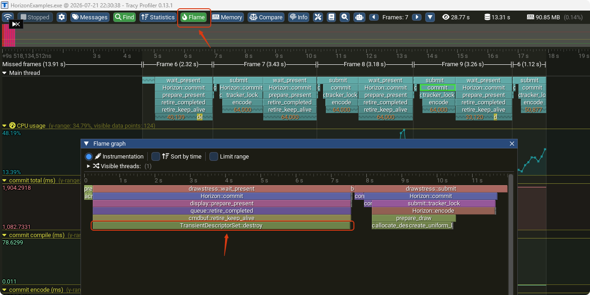

# Horizon

Ocarina 的着色器统一通过 C++ EDSL 构建 AST，再生成 Slang、编译为 SPIR-V，
最终在 Vulkan Compute 后端执行。

Ocarina 的源码目录已合并到 `src/`，旧 Horizon 的独立模块已移除。
共享日志由 `src/logging/` 提供，Ocarina 的结构体布局 tuple 位于 `src/core/tuple.h`。

## Windows 构建指南

这份指南适用于第一次接触 CMake 和 Conan 的 Windows 开发者。所有命令都在仓库根目录执行。

### 1. 准备工具

完整渲染器的本机验证以 **Windows x64** 为主；`core` 目标族另有 Windows、Linux 和 macOS CI。
Windows 推荐按下面顺序安装；安装后重新打开 PowerShell，使 `PATH` 生效。

- Git：首次获取源码可使用 Git 或下载源码压缩包；构建时缺少 Git 会通过 Conda 自动安装。
- [Miniforge / Miniconda / Conda](https://docs.conda.io/)：管理 Python、Conan、Git 和 Ninja，构建时自动准备这些工具。
- CMake **4.0 或更高版本**：需预先安装并能在终端中运行。所有 preset 使用 Ninja，缺少 Ninja 时通过 Conda 自动安装。
- Visual Studio 或 Visual Studio Build Tools：安装“使用 C++ 的桌面开发”、MSVC x64/x86 生成工具和 Windows SDK。项目会自动识别本机已安装的 VS/MSVC，不限定某个 VS 年份。
- Vulkan 开发组件：Vulkan Headers、Loader、Volk、VMA 和 Slang 由 Conan 提供，无需单独安装 Vulkan SDK。Windows 构建会部署 Conan 的 `vulkan-1.dll`；运行时仍需支持所需 Vulkan 功能的 GPU 驱动。Ocarina 固定使用 Vulkan Compute。
- VS Code 和 **CMake Tools** 扩展：仅在使用 VS Code 构建时需要。

先在 PowerShell 运行以下命令。它们都能显示版本号，就说明基础工具已准备好：

```powershell
conda --version
cmake --version
```

如果提示“找不到命令”，请检查对应工具是否已安装并加入 `PATH`，然后重新打开终端。
通过根 CMake preset 配置时，会自动创建或复用 `horizon-dev` 环境。
如果直接运行 `build_tools/dev.py`，则需先创建开发环境，再通过 `conda run -n horizon-dev python ...` 运行：

```powershell
conda create --yes --name horizon-dev --override-channels --channel conda-forge "python>=3.11" "conan>=2.28,<3"
```

第一次创建环境和配置会下载或编译 Conan 依赖，耗时较长是正常现象。

Git 优先复用 PATH 或当前 Python 所属 Conda 环境中的可用程序；Ninja 还会优先检查当前构建目录的缓存路径。
缺失或无法运行时，通过 conda-forge 安装或修复到当前 Python 所属的 Conda 环境，并复检版本命令。
安装仅更新当前进程和子进程的 PATH，不修改系统环境变量。两个工具在 Conan 编译依赖前准备好；
`conan_cache.py update` 同样会准备工具，`status` 只自动准备 Git，`clean` 不安装工具。
Conda 安装使用环境内的 `conda-meta/corona-tools.lock`，与 CoronaEngine 共用同一环境时也会互斥。
失效的 Ninja 缓存会在配置时替换；`build-fast` 会先刷新环境并重新配置，再启动构建。

若仓库根目录已有 `.venv`，CMake 自动配置会优先使用其中的 Python 和 Conan，
无需先激活环境或安装 Conda。该环境须包含 Python >=3.11 和 Conan >=2.28、<3，且已有可用的 Git 和 Ninja；普通 `.venv` 不会通过 Conda 安装工具。
不存在 `.venv` 时，继续使用上面的 Conda 流程。

CLion 使用 Visual Studio 工具链时，可以直接加载项目的 CMake 配置；依赖准备会识别
项目 `.venv`。新增源码或修改 CMake 后执行 **Reload CMake Project**，再构建所需 target。
同时刷新多个配置时，共用 Conan home 的 Horizon 开发脚本会对配方导出、依赖安装和环境
生成加进程锁；等待中的配置会打印提示，前一个依赖准备流程结束后自动继续。
Ninja + MSVC 构建会保存本次配置的 Conan 环境，并在每次 C/C++ 编译、链接时加载，
避免 IDE 缓存的旧版 MSVC 头文件或库路径混入构建。编译输出中的头文件依赖提示会
统一为固定格式，保证终端与 CLion 使用不同输出编码时仍能正确触发头文件重编译。
已有构建目录更新到此配置后，先执行 **Reload CMake Project**；编译命令变化会触发重编译。

### 2. VS Code / CMake Tools 构建

安装 VS Code 的 **CMake Tools** 扩展后，建议启用 VS 开发环境，使 IDE 使用正确的工具链：

1. 打开设置，搜索 `CMake: Use VS Developer Environment`，选择 `always`。
2. 或打开“首选项：打开用户设置(JSON)”，加入：

   ```json
   "cmake.useVsDeveloperEnvironment": "always"
   ```

CMake Tools 会单独启动构建进程。项目已为 Ninja + MSVC 的 C/C++ 编译和链接恢复 Conan 环境；
上面的设置仍能使 IDE 启动的其他开发工具获得一致的 MSVC 和 Windows SDK 环境。

接着打开仓库根目录，按 `Ctrl+Shift+P`：

1. 运行 **CMake: Select Configure Preset**，选择一个 `*-debug` preset。
2. 运行 **CMake: Configure**。
3. 在 CMake 的目标列表中选择需要的 target，再运行 **CMake: Build**。

| 使用场景 | 选择的 Debug preset | 构建目录 |
| --- | --- | --- |
| 共享日志、存储、tuple 与 hotfix 基础测试 | `core-debug` | `build/conan/core/debug` |
| Horizon / Helicon 渲染库 | `engine-debug` | `build/conan/engine/debug` |
| ShaderCompileScripts | `tools-debug` | `build/conan/tools/debug` |
| HorizonExamples | `examples-debug` | `build/conan/examples/debug` |
| Ocarina | `ocarina-debug` | `build/conan/ocarina/debug` |
| Ocarina 的 `test-*` 测试 | `ocarina-tests-debug` | `build/conan/ocarina-tests/debug` |

使用完整的目标族 preset 名，例如 `examples-debug`。每个目标族使用独立目录，切换 preset 后请重新执行 Configure，不要把不同目标族混在同一个构建目录里。

### 3. 用脚本构建

脚本会自动执行 Conan 安装、加载 VS 环境并配置 CMake；适合不想操作 IDE 的情况。

```powershell
# 配置 Examples 的 Debug 构建
conda run -n horizon-dev --no-capture-output python build_tools/dev.py configure --configuration Debug --target-family examples

# 配置并构建一个目标；脚本会从目标名自动判断目标族
conda run -n horizon-dev --no-capture-output python build_tools/dev.py build HorizonExamples --configuration Debug

# 同一目标族可以一次构建多个目标
conda run -n horizon-dev --no-capture-output python build_tools/dev.py build Horizon Helicon --configuration Debug

# 已配置过时，快速构建该目标族的全部 target
conda run -n horizon-dev --no-capture-output python build_tools/dev.py build-fast all --configuration Debug --target-family examples
```

把 `examples` 换成 `core`、`engine`、`tools`、`ocarina` 或 `ocarina-tests`，即可构建相应目标族。`Debug` 的大小写必须保持不变；还可使用 `Release`、`RelWithDebInfo` 和 `MinSizeRel`。

热更新统一使用跨平台 CMake 后端，`horizon-hotfix` 及其基础测试属于 `core`，不依赖 Ocarina。

#### 第一次阅读渲染示例

运行 `HorizonExamples` 或 `HorizonExamples baseline_slang` 均会打开 Baseline Slang。在下表第一行的 `BaselineSlang` 构造函数中可以看到 Viking Room 的模型、纹理、相机和渲染目标的初始化，`run(seconds)` 中是每帧的矩阵更新、绘制和呈现。各 Baseline 示例和 Tutorial 共用 [Baseline/assets](examples/Baseline/assets) 中的模型、材质和纹理。

| 场景和阅读重点 | EDSL 实现 | Slang 实现 | Slang Mesh 实现 | Slang RayTrace 实现 |
| --- | --- | --- | --- | --- |
| Baseline · 绘制一个带纹理的模型 | [example_baseline_edsl.cpp](examples/Baseline/EDSL/example_baseline_edsl.cpp) | [example_baseline_slang.cpp](examples/Baseline/Slang/example_baseline_slang.cpp) | [example_baseline_mesh.cpp](examples/Baseline/Mesh/example_baseline_mesh.cpp) | [example_baseline_raytrace.cpp](examples/Baseline/RayTrace/example_baseline_raytrace.cpp) |
| EDSL Feature · G-buffer 与计算着色 | [example_edsl_feature.cpp](examples/Feature/example_edsl_feature.cpp) | — | — | — |
| Disney · 球体阵列与材质 | [example_disney_edsl.cpp](examples/Disney/EDSL/example_disney_edsl.cpp) | [example_disney_slang.cpp](examples/Disney/Slang/example_disney_slang.cpp) | [example_disney_mesh.cpp](examples/Disney/Mesh/example_disney_mesh.cpp) | [example_disney_raytrace.cpp](examples/Disney/RayTrace/example_disney_raytrace.cpp) |
| DrawStress · 用一张间接命令表绘制立方体网格 | [example_drawstress_edsl.cpp](examples/DrawStress/EDSL/example_drawstress_edsl.cpp) | [example_drawstress_slang.cpp](examples/DrawStress/Slang/example_drawstress_slang.cpp) | [example_drawstress_mesh.cpp](examples/DrawStress/Mesh/example_drawstress_mesh.cpp) | [example_drawstress_raytrace.cpp](examples/DrawStress/RayTrace/example_drawstress_raytrace.cpp) |

运行 `HorizonExamples edsl_feature` 可查看 EDSL 如何调用外部着色器函数。片元入口调用 GLSL 函数计算立方体的表面颜色，将颜色和法线写入 G-buffer。计算入口逐像素读取这两张图像，调用 HLSL 函数计算光照并输出到窗口。[GLSL 辅助函数](examples/Feature/edsl_feature_geometry.glsl) · [HLSL 辅助函数](examples/Feature/edsl_feature_lighting.hlsl)

每个模式的派生类都声明在示例目录下的头文件中。[main.cpp](examples/main.cpp) 根据参数创建窗口，把原生句柄传给所选示例的构造函数，在主循环中每帧调用一次 `run(seconds)`。派生类自己持有渲染资源，并在析构时释放。Disney 场景使用 [Disney/assets/env](examples/Disney/assets/env) 中的环境贴图。手写 Slang 的每个阶段单独编译。调整 Vulkan 绘制布局时需要核对各阶段的推送常量偏移，以及顶点与片元之间传递的参数位置。[Baseline 顶点](examples/Baseline/Slang/baseline_vert.slang) · [Disney 片元](examples/Disney/Slang/disney_frag.slang) · [DrawStress 顶点](examples/DrawStress/Slang/drawstress_vert.slang)

Disney 光栅示例在初始化时上传球体几何、110 份材质球参数和间接命令，每帧复用这些缓冲。DrawStress 光栅示例每帧将立方体的变换矩阵写入映射的参数缓冲，调用 `flushMapped()` 后将缓冲作为逐 draw 参数传给光栅管线。[Disney 场景](examples/Disney/Slang/example_disney_slang.cpp) · [DrawStress 绘制](examples/DrawStress/Slang/example_drawstress_slang.cpp)

最后可以阅读 Tutorial 的原生 Vulkan 实现，对照 Vulkan 初始化、Viking Room 绘制和资源释放的顺序。Tutorial 的源码作为独立参考保留。[原生入口](examples/Baseline/Tutorial/28_model_loading.cpp) · [Loading models](https://vulkan-tutorial.com/Loading_models)

#### 用 Ocarina 追踪同一组场景

构建 `HorizonExamples` 时会自动编译三个 Ocarina 示例及其 Vulkan Compute 后端。先从仓库根目录编译，再选择一个模式。运行光追需要支持 Vulkan 加速结构和 ray query 的 GPU。

```powershell
cmake --preset examples-release
cmake --build --preset examples-release --target HorizonExamples
$examples = Resolve-Path build/conan/examples/release/bin/Release/HorizonExamples.exe
& $examples baseline_ocarina
```

| 模式 | 从入口阅读的内容 |
| --- | --- |
| `baseline_ocarina` | 载入 Viking Room，建立三角形加速结构，为每个像素发出相机射线。命中后插值 UV、采样模型纹理，与 Tutorial 显示相同的无光照材质。[源码](examples/Baseline/Ocarina/example_baseline_ocarina.cpp) |
| `disney_ocarina` | 110 个实例共用一个球体，用命中的实例编号选择 Disney 材质。三个 Disney 模式都使用同一束方向光，并从两张 DDS 环境贴图采样漫反射和镜面光照。相机固定在材质球阵列前。[源码](examples/Disney/Ocarina/example_disney_ocarina.cpp) |
| `drawstress_ocarina` | 默认 40³ 个立方体共用一份底层加速结构（BLAS）。每帧更新变换并更新顶层加速结构（TLAS）。三个 DrawStress 示例各自的类头文件中都有 `dim` 常量，可将网格边长设为 2 到 40。[源码](examples/DrawStress/Ocarina/example_drawstress_ocarina.cpp) |

各模式使用固定 800 × 600 的带边框窗口和渲染目标。三个光追模式将 RGBA 像素读回并交给 Horizon 窗口呈现。[Disney 光追](examples/Disney/Ocarina/example_disney_ocarina.cpp)

窗口标题每帧显示模式、实时帧率和本帧实际耗时，例如 `baseline_slang | 125.0 FPS | 8.00 ms`。Baseline 和 DrawStress 的动画从首帧零秒开始。将主循环中的 `fixed_dt` 设为正数可指定动画每帧推进的秒数，帧率和耗时仍按实际时间计算。[主循环](examples/main.cpp)

构建实现位于 `build_tools/`：Python 入口、CMake 模块、Conan 配方/profile 和构建工具测试均在这里。
根目录 `CMakeLists.txt`、`CMakePresets.json` 保留薄入口；构建输出仍写入根目录的 `build/`。
直接使用 Conan 时执行 `conan install build_tools/conanfile.py`，并指定所需 profile 和选项。
`tools/` 保留 ShaderCompileScripts 的 C++ 源码和资产处理工具，模块的目标声明与代码生成器保留在源码旁。

缓存管理使用 `python build_tools/conan_cache.py`。`update` 与开发脚本共用平台选择和依赖安装流程，
可用 `--target-family` 指定目标族；安装、更新与缓存删除使用 Conan home 下的 `.horizon-install.lock`，
覆盖共用缓存的多个 Horizon 工作区。单包更新的临时文件写入 `build/conan/cache/`。

构建工具与源码检查可分别运行：

```powershell
python -B -m unittest discover -s build_tools/tests -p "test_*.py"
python src/core/generate_tuple.py --check
python -B -m unittest discover -s src/tests -p "test_*.py"
```

### 4. 新增 target 和依赖

先确定新 target 属于哪个现有目标族。修改后必须重新执行 Configure，CMake Tools 才会显示新 target。

- **只新增 target，或只使用项目内/已存在的依赖**：只修改对应的 `CMakeLists.txt`，添加 target 并链接已有库；不需要修改 Conan。
- **新增第三方依赖**：同时修改两处。先在 `build_tools/conanfile.py` 用 `self.requires(...)` 声明依赖，并让它只在需要的目标族启用；再在 CMake 中 `find_package(...)` 并用 `target_link_libraries(...)` 链接。不要在 CMake 中用 `FetchContent` 下载第三方库。
- **希望用脚本直接构建新 target**：若它不符合现有名称规则，还要在 `build_tools/dev.py` 的 target 到目标族映射中登记；否则脚本可能选择错误的 preset。
- **新增一个完整的目标族**：除 CMake 和 Conan 外，还要新增 CMake preset、Conan 选项、脚本的目标族选项和 target 映射，确保它使用独立的构建目录。

例如，新增一个不引入第三方库的 Ocarina 测试，只需在 `src/tests/CMakeLists.txt` 增加：

```cmake
ocarina_add_test(test-my-check CATEGORY core SOURCES core/test_my_check.cpp)
```

重新配置 `ocarina-tests-debug` 后，`test-core-my-check` 会出现在 target 列表中；不需要修改 Conan。

### Ocarina 运行时光追模式

每次创建 shader 时，`ShaderCompileOptions::trace_mode` 决定这次编译请求。已有的 `compile(kernel, name)` 和 `async_compile` 调用默认使用 `Auto`。没有实际 trace 调用的 kernel 始终生成普通 compute shader。对带有 `trace_closest` 或 `trace_occlusion` 的 kernel（包括 callable 中的调用），`Auto` 优先选择设备已启用的 ray query。只有设备缺少 query、具备原生光追管线且 kernel 语义兼容时，才选择 raygen 管线。

```cpp
using namespace ocarina;
auto caps = device.trace_capabilities();
auto shader = device.compile(kernel, "camera", CS, ShaderCompileOptions{TraceMode::Auto});
auto requested = shader.requested_options().trace_mode;
auto actual = shader.execution_mode();  // Compute, ComputeRayQuery, RayTracingPipeline
if (caps.ray_tracing_pipeline) {
    auto native = device.compile(kernel, "native-camera", CS,
                                 ShaderCompileOptions{TraceMode::RayTracingPipeline});
    stream << native(ray_buffer, hit_buffer).dispatch(width, height) << commit();
}
```

同一 kernel 可以创建多个 shader，每个 shader 的模式固定。四参数重载也接受 `TraceMode::RayQuery`。强制模式不可用或 kernel 不兼容时，创建失败。普通编译或提交错误同样会直接报错。原生路径支持三角形 closest-hit、遮挡查询及完整的一至三维 dispatch。任一维为零时跳过提交，超出设备每维或总调用数上限时拒绝。依赖 shared memory、工作组 barrier、block/thread 内建值、warp 操作、自定义 Slang 代码或 header 的 trace kernel 需要 query 路径。可以用 `trace_capabilities().ray_query` 查询该能力。`supports_raytracing()` 表示至少一条路径可用。本次后端虚接口发生变化，更新后请统一重建应用和后端模块。

修改 trace 选择、代码生成、缓存、AS 或提交逻辑时，提交前在实体 GPU 上运行本地对照。记录 GPU 型号、驱动及版本、启用的能力、请求和实际模式、命令、正确性和计时结果。只支持单一路径时，注明另一条路径未验证。测试开关默认关闭，独立目标使用 `trace-mode-local` 标签。

```sh
python build_tools/dev.py install --configuration Release --target-family ocarina-tests
cmake --preset ocarina-tests-release -DHORIZON_BUILD_TRACE_MODE_TESTS=ON
python build_tools/dev.py build-fast ocarina-trace-mode-tests --configuration Release --target-family ocarina-tests
ctest --test-dir build/conan/ocarina-tests/release -C Release -L trace-mode-local --no-tests=error -V
```

`horizon.trace_mode.performance` 在同一设备、同一场景、同一批射线和输出上报告两条路径的 shader 创建耗时、Vulkan timestamp 平均每次 dispatch 耗时，以及批次从提交 16 次 dispatch 到读回完成的耗时。后两项均在预热后测量。保留 CTest 的详细日志，记录因缺少设备能力而跳过的用例。

### 在 CLion 运行 All CTest

选择 `ocarina-tests-local-release` CMake preset，构建后运行 **All CTest**。这个配置会注册新版 Core、Hotfix、Python、Ocarina，以及本地光追和 warp32 测试。已有个人 profile 可以设置 `HORIZON_BUILD_TRACE_MODE_TESTS=ON` 和 `HORIZON_BUILD_WARP32_TESTS=ON`。命令行可以使用同一套配置：

```sh
cmake --preset ocarina-tests-local-release
cmake --build --preset ocarina-tests-local-release
ctest --preset ocarina-tests-local-release
```

修改光追或 warp32 相关代码时，在支持对应能力的实体 GPU 上运行专项测试。保留运行记录，并标明因缺少能力而跳过的用例。

```sh
ctest --preset ocarina-tests-local-release -L '^(trace-mode-local|warp32-local)$' -V
```

CI 的 Ocarina 配置默认关闭这两个开关。普通计算、编译检查和 CPU 侧的 trace 分析仍在 CI 中运行。64 位 buffer atomics 在 Linux 和 Windows CI 运行，macOS 托管 runner 的驱动缺少此能力。使用相同的本地 CTest 用例和参数复现 CI：

```sh
python build_tools/dev.py build ocarina-tests horizon-tests --configuration RelWithDebInfo --target-family ocarina-tests --with-tests
python src/tests/run_ci_suite.py --build-dir build/conan/ocarina-tests/relwithdebinfo --configuration RelWithDebInfo --output build/verification/ocarina-ci
```

复现 macOS CI 时，给第二条命令加上 `--without-int64-atomics`。

### 常见问题

- **VS Code 中找不到标准头文件**：确认 `cmake.useVsDeveloperEnvironment` 已手动设置为 `always`，然后重新打开 VS Code 并重新 Configure。
- **Ocarina 配置找不到 VulkanLoader**：重新运行开发脚本的依赖安装/配置流程，确认 Conan 生成了 `VulkanLoader` 配置及 `Vulkan::Loader` 目标；Headers 和 Loader 版本需一致。SDK 验证层与调试工具可按需安装。
- **第一次构建很慢**：Conan 正在准备依赖；后续使用相同目标族和配置通常会快很多。

---

## Horizon 渲染接口的构建与验证

消费端在 CMake 中链接 `Horizon`，在 C++ 中包含 `Horizon.h` 即可使用渲染接口和拷贝命令。引擎与示例均使用
`src/HardwareWrapper` 和 `src/HardwareWrapperVulkan`。

```powershell
cmake --preset examples-relwithdebinfo
cmake --build --preset examples-relwithdebinfo --target horizon-tests
ctest --preset examples-relwithdebinfo
```

`engine` 和 `examples` 预设均启用 Horizon 测试。`examples` 的 `horizon-tests` 目标也构建
`HorizonExamples`。用 `HorizonExamples <mode>` 选择示例，省略参数时运行 `baseline_slang`。关闭窗口即可退出。

```powershell
cmake --build --preset examples-relwithdebinfo --target HorizonExamples
& ./build/conan/examples/relwithdebinfo/bin/RelWithDebInfo/HorizonExamples.exe drawstress_slang
```

手写着色器通过 `#include SLANG(...)`、`HLSL(...)` 或 `GLSL(...)` 引入。构建时生成的阶段对象自带 SPIR-V 和反射。计算管线写作 `ComputePipeline pipeline(compute_write_slang)`，光栅管线传入顶点和片元两个阶段对象。EDSL 在相同的构造位置传入 lambda。

拷贝、绘制、计算和呈现都返回 `HardwareExecutor::Command`，可以直接用 `executor <<` 入队，也可以先保存，再按需要的顺序入队。同一条命令可以多次入队。调用计算管线时，命令会保存本次 dispatch 的工作组数量、着色器变体、参数，以及该变体使用的资源和图像视图。之后给管线重新赋值，可以为下一条命令选择其他资源。

```cpp
const auto dispatch = compute(groupsX, groupsY, groupsZ);
executor << raster(vertexBuffer, indexBuffer, commands, count) << dispatch << display(image);
executor.commit();
```

呈现命令保存图像和显示器，重放时读取图像当时的内容。原生窗口由调用方保持有效。窗口最小化时跳过该帧的呈现，前后的 GPU 命令仍按入队顺序执行。

用 `baseline_mesh`、`disney_mesh` 或 `drawstress_mesh` 运行对应场景的手写 Slang mesh 版本。Baseline 分组读取 Viking Room 的索引和顶点。Disney 为 110 个材质球各提交一条间接记录。DrawStress 保留 40³ 个立方体和 64,000 条间接记录，每个工作组生成一个立方体，并通过 `SV_DrawIndex` 读取它的变换矩阵。三个模式都需要 mesh shader，Disney 和 DrawStress 还需要支持对应记录数的多次间接绘制。

用 `MESH_PAIRS` 登记生成头、mesh 和 fragment 文件，在 C++ 中分别引入阶段头并构造 `MeshPipeline mesh(baseline_mesh_slang, baseline_frag_slang)`。调用 `executor << mesh(groups, count, depth)` 时，GPU 从 `Usage::RasterIndirect` 缓冲读取前 `count` 条记录。每条 `MeshPipeline<>::IndirectPacket` 的三个 `uint32_t` 指定第一阶段在 X、Y、Z 上的工作组数。需要 task shader 时，用 `TASK_MESH_PAIRS` 在 mesh 前登记 task 阶段，构造时使用相同顺序。

用 `baseline_raytrace`、`disney_raytrace` 或 `drawstress_raytrace` 运行对应的光追场景。Baseline 在命中三角形时插值 UV 采样 Viking Room 纹理。Disney 的 110 个实例共享球体 BLAS，通过实例 ID 读取各自的材质。DrawStress 的 64,000 个立方体共享一个 BLAS，每帧更新实例变换并重建 TLAS。用 `RAY_TRACE_PIPELINES` 按生成头、raygen、miss、closest-hit 的顺序登记，在 C++ 中分别引入三个阶段头。首版支持索引三角形、一个三角形命中组和一级光线递归。

`RayTracePipeline<>::AccelerationStructure` 的两个 `build` 重载分别接收顶点和索引 buffer，或接收 `RayTracePipeline<>::Instance` 数组。顶点坐标为 `float3`，可传入顶点内的字节偏移。实例保存 BLAS、仿射变换、24 位 ID 和 8 位掩码。构建命令保留其输入，重新构建会替换目标句柄。已绑定或已捕获的场景继续引用原来的结构。

```cpp
executor << geometry.build(vertices, indices);
const std::array instances{RayTracePipeline<>::Instance{.geometry = geometry}};
executor << scene.build(instances);
pipeline.scene = scene;
pipeline.output = color;
executor << pipeline(width, height) << display(color);
executor.commit();
```

Slang 的场景声明使用 `[[vk::binding(1, 3)]] RaytracingAccelerationStructure scene`，set 3 的 binding 0 仍可用于相机 UBO。发射尺寸、绑定资源和 shader 参数在调用 `pipeline(...)` 时捕获。跨 executor 使用新构建的场景时，先提交构建，再用消费方的 `wait(&producer)` 登记依赖。

在目标中登记实际使用的顶点和片元着色器配对，即可通过具名字段绑定资源和输出。每组三个参数依次为生成头、顶点着色器、片元着色器。

```cmake
helicon_compile_shaders(HorizonExamples RASTER_PAIRS
    Baseline/Slang/baseline.pipeline.hpp
    Baseline/Slang/baseline_vert.slang
    Baseline/Slang/baseline_frag.slang)
```

在使用处分别引入两个阶段，顺序可以互换。

```cpp
#include "Horizon.h"
#include "Codegen/ControlFlows.h"
#include SLANG(Baseline/Slang/baseline_vert.slang)
#include SLANG(Baseline/Slang/baseline_frag.slang)
```

两个阶段都可见时，即可用 `RasterPipeline pipeline(baseline_vert_slang, baseline_frag_slang)` 构造管线，并直接赋值给 `pipeline.outColor` 和 `pipeline.vp.view`。共用同一 VS 的多个 FS 可以分别引入，每个已登记的配对都有自己的具名字段。也可以直接包含对应的配对头。接收任意实例的函数可将参数声明为 `ComputePipeline<CS>&` 或 `RasterPipeline<VS, FS>&`，由函数模板推导阶段类型。

EDSL 和 Slang 共用 `RasterPipeline<>` 中的光栅类型。构造管线时可以在 VS、FS 后传入 `RasterPipeline<>::State`，其中的 `compare`、`blend` 和 `topology` 分别使用 `RasterPipeline<>::Compare`、`RasterPipeline<>::Blend` 和 `RasterPipeline<>::Topology`。每次绘制可单独指定 `RasterPipeline<>::ScissorRect`。

`executor << pipeline(vertexBuffer, indexBuffer, commands, count)` 将命令缓冲中的前 `count` 条绘制记录入队。每次调用独立选择几何缓冲、参数和裁剪矩形。执行器按入队顺序绘制，将兼容的相邻绘制合并到同一 render pass。CPU 预先生成的间接命令可以与顶点和索引一起上传，并在后续帧中复用。

```cpp
HardwareExecutor executor;
HardwareBuffer vertexBuffer, indexBuffer, commands;
executor << vertexBuffer.createDeviceLocal(HardwareBuffer::Usage::VertexBuffer,
                                           vertices.data(), vertices.size(), sizeof(vertices[0]));
executor << indexBuffer.createDeviceLocal(HardwareBuffer::Usage::IndexBuffer,
                                          indices.data(), indices.size(), sizeof(indices[0]));
const RasterPipeline<>::IndirectPacket packet{.vertexCount = static_cast<uint32_t>(indices.size()), .instanceCount = 1};
executor << commands.createDeviceLocal(HardwareBuffer::Usage::RasterIndirect, &packet, 1, sizeof(packet));

executor << pipeline(vertexBuffer, indexBuffer, commands, 1);
executor.commit();
```

`createDeviceLocal` 替换当前句柄指向的分配，并在返回前将源数据复制到暂存缓冲。返回的 `HardwareExecutor::Command` 持有暂存缓冲和目标缓冲，调用方用 `executor <<` 将上传排在首次使用之前。元素数以记录为单位，元素大小以字节为单位。调用方应传入可平凡复制的顶点以及 `uint16_t` 或 `uint32_t` 索引。接口会检查顶点步长为 4 字节的倍数、索引宽度为 2 或 4 字节。

调用光栅管线时，绘制命令会捕获当前管线、EDSL 变体、绑定和附件。需要深度测试时，创建 `HardwareImage::Usage::DepthImage` 图像，在 `parameters` 后传入，例如 `pipeline(vertices, indices, commands, count, parameters, depth)`。省略 `depth` 会关闭深度测试和写入。渲染尺寸默认从颜色或深度附件推导，也可以通过最后一个参数 `extent` 指定。

首次绘制默认清除已绑定的附件。面向相同附件和范围的连续绘制会延续同一逻辑 pass。要主动开始新的逻辑 pass，在 `scissor` 之后显式传入 `RasterPipeline<>::Pass{}`。两遍绘制可以传入同一张深度图，第二遍用 `RasterPipeline<>::Pass{.loadColor = true, .loadDepth = true}` 保留上一遍的颜色和深度。只清除颜色时写 `executor << pipeline({}, {}, {}, 0, {}, {}, {}, RasterPipeline<>::Pass{})`。拷贝、计算、呈现和提交都会结束当前逻辑 pass。

手写 Slang 通过参数索引描述符表时，给字段赋一个 `HardwareExecutor::Descriptor`。例如 Baseline 使用 `pipeline.vp.texIndex = texture_image.storeSampledDescriptor()`。公开枚举 `HardwareExecutor::Descriptor::Use` 包含 `Read`、`Write`、`ReadWrite` 和 `Sampled`。缓冲和存储图像分别用 `storeReadDescriptor()`、`storeWriteDescriptor()` 或 `storeReadWriteDescriptor()` 表达本次访问。图像的过滤采样用 `storeSampledDescriptor()`，按坐标读取存储图像用 `storeReadDescriptor()`。这些值可以保存和复制，持有对应的资源或图像视图。Slang 反射出的直接资源字段和固定槽位仍可写成 `pipeline.outputs[3] = buffer`，读写范围由 shader 声明决定。EDSL 从代理的赋值、读取和采样处记录用途。

命令创建时保存绑定及其访问方式。EDSL 会按当前主机条件选择变体，GPU 条件会合并各条可能执行的路径。希望某个采样或导入函数的资源只在特定变体中登记时，把调用也写在对应的 `$IF` 分支里。同一张图在一条管线里同时用于采样和存储时，给两个 EDSL 代理绑定同一张图，分别用于 `sample()` 和下标访问。

普通整数赋值会清除该字段先前的描述符绑定。手写 shader 通过整数选择槽位时，应先绑定所有可能访问的资源，并覆盖实际的读写权限，包括间接查表和导入函数中的访问。原子读改写使用 `storeReadWriteDescriptor()`。同步跟踪整个 buffer 或图像视图覆盖的 mip 和图层。光栅间接绘制的顶点、索引、命令、参数和附件由绘制命令捕获。

执行器根据命令捕获的访问安排屏障。管线状态和绑定相同、只有着色器读取的相邻绘制仍可合并到同一物理 pass。涉及 shader 存储写入时会拆分物理 pass，保留附件内容并继续累计 `drawIndex()`。跨执行器的提交依赖仍由调用方显式登记。

将旧写法 `a << b << cmd` 改为 `b << cmd` 即可保留原有的入队行为。如果 `b` 的工作依赖 `a` 的提交，先调用 `a.commit()`，再用 `b.wait(&a)` 让 `b` 的下一次提交等待 `a` 最近一次成功提交。调用 `b.wait()`、`b.wait(nullptr)` 或 `b.wait(&b)` 会阻塞 CPU，直到 `b` 已提交的工作完成。排队中的命令留到下一次 `commit()` 提交。

旧代码原先未被 CMake 收集，两份公共头文件也被整体注释，因此默认构建成功并不能证明旧版可编译。
恢复构建后，主要迁移点如下：

| 层次 | 发现的问题 | 修复方式 |
| --- | --- | --- |
| 公共接口 | 旧文件名、缺少有效头文件保护和标准头文件 | 将渲染接口和拷贝命令合并到 `Horizon.h`，由实现显式包含 |
| 日志 | 引用已移除的 Corona Kernel 路径 | 使用 Core/Quill 日志 |
| 宿主内存 | 引用旧的对齐分配器 | 使用 C++ 对齐 `operator new/delete`，保存分配对齐值，先销毁导入缓冲区再释放内存 |
| 着色器 | `getShaderCode` 已改为可变操作，SPIRV-Cross 反射已移除 | 适配当前 Helicon API，使用 Slang 产生的二进制和反射 |
| 资源自动绑定 | 新版反射条目可能表示常量或缓冲区，旧代码统一按图像解引用 | 分别处理值、缓冲区和图像，并检查空的回指针 |
| Vulkan 链接与初始化 | 重复定义 Volk、依赖未导出的平台扩展变量、全局初始化要求程序启动时就有 GPU | 链接现有 Volk，查询平台扩展入口，首次 GPU 操作时初始化上下文 |
| 拷贝与所有权 | 偏移和长度被丢弃；同一资源重复锁定；部分图像 barrier 与整体布局记录不一致 | 传递并校验拷贝范围；修复同槽锁定；图像转换与整体布局记录保持一致 |
| 图像释放 | `destroyImage` 的释放代码被注释，退出时触发 VMA 泄漏断言 | 分配和缓存视图由共享所有权管理，最后一个图像/子视图释放时销毁 |

旧版 RHI 的 `HardwareBuffer` 和 `HardwareImage` 通过 `std::shared_ptr` 持有各自的 Vulkan 资源包装对象。
拷贝命令持有资源包装对象，executor 通过 timeline semaphore 保留资源到 GPU 完成。
测试覆盖头文件独立包含、无窗口 displayer 的移动语义、
临时缓冲区保活、整块/局部/同缓冲区拷贝、越界拒绝、图像 mip/数组层/偏移往返和子视图保活，
以及使用生成的 Slang 阶段和 EDSL 创建计算管线后的 GPU 写入与读回。
光栅测试通过像素回读验证 GPU 生成的间接绘制命令和多 pass 的颜色、深度附件加载。
CPU 测试不初始化 Vulkan；GPU 测试要求 Vulkan 1.4，无相应 loader/device 时明确返回 CTest 的 skip 状态。
设备存在但初始化、编译或执行失败会报错，不会被当成跳过。

**迁移手写着色器**　原先传入源码字符串或 `ShaderCodeModule` 的调用应改为引入着色器文件并传入阶段对象。已有工程需要用当前版本的 ShaderCompileScripts 重新生成着色器头。

Linux 窗口 surface 创建尚未实现。

## tracy用法

1、cmake打开

option(HORIZON_ENABLE_TRACY "Enable Tracy profiler instrumentation" OFF)
->
option(HORIZON_ENABLE_TRACY "Enable Tracy profiler instrumentation" ON)

2、为需要分析的目标链接 `Tracy::TracyClient`，定义 `HORIZON_TRACY_ENABLED=1`，添加埋点后编译并启动该目标。

3、打开tracy-profiler.exe 点Connect

4、如果是一帧里调用多的看 火焰图


## Shader 资源使用与设计

### Vulkan 间接绘制的 shader 约定

Horizon 通过 `vkCmdDrawIndirect` 提交批次，顶点输入状态为空。手写 shader 自行声明所用字段、读取顶点，并决定各阶段之间传递什么。入口为 `main`。下面的字段名仅供对照，二进制接口由字节偏移、宽度和数组步长决定。

Helicon 的光栅 EDSL 统一生成使用这套间接绘制布局的 SPIR-V，直接调用 `RasterPipelineObject::compile()` 也采用同一布局。顶点 lambda 可以写成 `[](Float3 position, Float2 uv)`，Helicon 按形参顺序从顶点记录读取属性。手写 shader 可参考 [手写 Slang 顶点着色器](examples/Baseline/Slang/baseline_vert.slang) 与[片元着色器](examples/Baseline/Slang/baseline_frag.slang)。

| 数据 | 字节偏移与字段 | 大小 |
| --- | --- | --- |
| 光栅 push constant | 0 命令表地址、8 几何表地址、16 参数区地址（均为 64 位设备地址），24 表内起点 `groupBase`、28 逻辑 pass 内起点 `drawBase`（均为 `uint32`） | 32 字节 |
| 命令表元素（`RasterPipeline<>::IndirectPacket`） | 0 `vertexCount`、4 `instanceCount`、8 `firstVertex`、12 `firstInstance`、16 `geometryIndex`、20 `firstIndex`、24 `baseVertex`、28 `parameterWord`。各字段为 32 位，`baseVertex` 有符号 | 32 字节 |
| 几何表元素 | 0 顶点地址、8 索引地址（均为 64 位设备地址），16 `strideWords`、20 `indexBytes`、24 `vertexCount`、28 保留（均为 `uint32`） | 32 字节 |

- **定位 draw**。每次调用光栅管线都从所传命令表的第 0 条开始读取。后端按设备的单次绘制数量上限分段，shader 使用 `groupBase + SV_DrawIndex` 定位当前表中的 packet。再加上 `drawBase` 就得到 EDSL 的 `drawIndex()`，它在同一逻辑 pass 内跨调用连续编号。即使后端为同步资源而拆分 render pass，后续绘制也会加载已有附件并接着编号。零条命令和完全落在目标外的裁剪区域不占编号。
- **读取顶点**。对 `firstVertex = 0` 的索引拉取，读取第 `firstIndex + gl_VertexIndex` 个索引（Slang 使用 `SV_VertexID`）。`indexBytes` 为 2 或 4。将解码后的索引加上 `baseVertex`，有效范围为 `[0, geometry.vertexCount)`。顶点字节地址为 `vertices + 4 × strideWords × 顶点下标`。属性类型和字节偏移由应用的顶点数据格式决定。Vulkan 实例下标已包含 `firstInstance`。
- **读取 draw 参数**。有逐 draw 参数时，使用 `executor << pipeline(vertexBuffer, indexBuffer, commands, count, parameterBuffer)`。调用方先将参数上传到 `HardwareBuffer::Usage::StorageBuffer`，也可以让 compute shader 写入该缓冲。每个 packet 的 `parameterWord` 是从该缓冲起点计算的偏移，以 4 字节为单位。调用方负责范围和类型对齐。绘制命令持有缓冲引用，CPU 再次覆盖同一区域前应等 GPU 读完。每次调用的命令共用几何表项 0。
- **首实例**。每个 packet 的 `firstInstance` 指定起始实例编号。设备未启用 `drawIndirectFirstInstance` 时，生成 packet 的 CPU 或 GPU 代码必须将该字段设为零。
- **片元接口**。如果片元需要本次 draw 的参数，可以从顶点传递一个 `flat uint` 字偏移，双方选用同一个空闲 location。`disney_slang` 和 EDSL 的自动取数使用 15。`baseline_slang` 只在顶点阶段读取逐 draw 参数，片元阶段直接从共享 UBO 取得纹理索引。
- **绑定**。光栅 push constant 由后端按上表写入。每个 pass 的共享数据可以使用下面的 UBO 绑定。计算管线可自行定义 push constant 布局。

### Descriptor Set 约定

Helicon 的光栅和计算 EDSL 都通过 bindless 描述符表访问纹理和 `Array<T>` 资源。每个阶段只生成一份绑定布局，使用 `getShaderCode(language)` 取得编译结果。计算 shader 的资源句柄写入 push constant，光栅 shader 的共享资源句柄写入 set 3 的 UBO。间接绘制的顶点、索引和逐 draw 参数通过上节的设备地址读取。

需要生成离线 shader 缓存时，启用 `HORIZON_ENABLE_HARDCODE_SHADERS` 并运行带 `CABBAGE_ENGINE_DEBUG` 的构建。请重新生成已有的 EDSL 光栅 shader 缓存，以包含 `instanceIndex()` 的首实例偏移修正。

| Set | 用途 |
| --- | --- |
| set 0 | bindless 纹理表（combined image sampler） |
| set 1 | bindless storage buffer |
| set 2 | bindless storage image |
| set 3 | per-pass 共享 UBO |

### REBLUR GPU 时间戳诊断

启用 `REBLUR_GPU_PROFILE` 时，可额外将 `REBLUR_GPU_PROFILE_DIAGNOSTICS`
设为另一个 CSV 文件路径，记录原始 GPU begin/end tick、时间戳周期及有效位掩码，
以及同一批次提交、fence 等待和 query 读取前后的 CPU 时钟。两份输出必须是不同文件。
Windows CPU 时钟使用 QPC，其他平台使用 steady_clock 纳秒；频率写入 CSV。
此诊断不增加 GPU 命令或改变 query 边界，开启后每批次增加六次 CPU 时钟读取及
fence 完成后的 CSV 写入。CPU 与 GPU 时钟有频率偏差，跨时钟关联需要校准，
不能直接相减。未设置诊断变量时不采集这些时钟或写入附加 CSV。

`REBLUR_GPU_PROFILE_MODE=intervals` 为 REBLUR 同时采集五个共享的
`BOTTOM_OF_PIPE` 时间点，输出 `REBLUR-Pack`、`REBLUR-NRD`、
`REBLUR-Unpack`、`REBLUR-Epilogue` 和 `REBLUR-Filter`。
完整区间直接取首尾时间戳，满足 `Filter = Pack + NRD + Unpack + Epilogue`。
Pack 结束于其可见性屏障之后；NRD 结束于最终 dispatch 之后、出站依赖屏障之前，
该屏障计入 Unpack。Unpack 结束于输出屏障之后。EDSL 没有额外的资源状态恢复，
Epilogue 的两个时间点相邻。原来的逐 dispatch、`nrd` 和 `filter` 模式保留。
