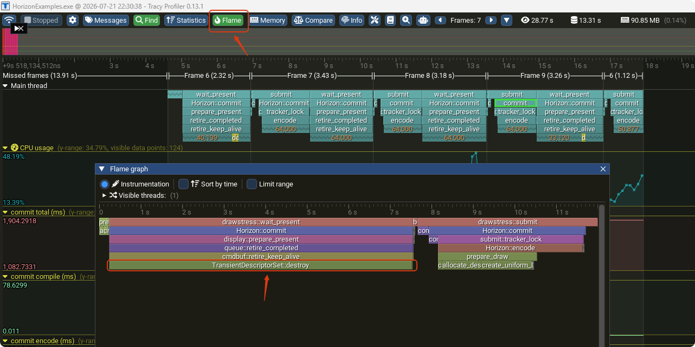

# Horizon

Ocarina 的着色器统一通过 C++ EDSL 构建 AST，再生成 Slang、编译为 SPIR-V，
最终在 Vulkan Compute 后端执行。

Ocarina 的源码目录已合并到 `src/`，旧 Horizon 的独立模块已移除。
共享日志由 `src/logging/` 提供，Ocarina 的结构体布局 tuple 位于 `src/core/tuple.h`。

## Windows 构建指南

这份指南适用于第一次接触 CMake 和 Conan 的 Windows 开发者。所有命令都在仓库根目录执行。

### 1. 准备工具

完整渲染器的本机验证以 **Windows x64** 为主；`core` 目标族另有 Windows、Linux 和 macOS CI。
Windows 推荐按下面顺序安装；安装后重新打开 PowerShell，使 `PATH` 生效。

- Git：首次获取源码可使用 Git 或下载源码压缩包；构建时缺少 Git 会通过 Conda 自动安装。
- [Miniforge / Miniconda / Conda](https://docs.conda.io/)：管理 Python、Conan、Git 和 Ninja，构建时自动准备这些工具。
- CMake **4.0 或更高版本**：需预先安装并能在终端中运行。所有 preset 使用 Ninja，缺少 Ninja 时通过 Conda 自动安装。
- Visual Studio 或 Visual Studio Build Tools：安装“使用 C++ 的桌面开发”、MSVC x64/x86 生成工具和 Windows SDK。项目会自动识别本机已安装的 VS/MSVC，不限定某个 VS 年份。
- Vulkan 开发组件：Vulkan Headers、Loader、Volk、VMA 和 Slang 由 Conan 提供，无需单独安装 Vulkan SDK。Windows 构建会部署 Conan 的 `vulkan-1.dll`；运行时仍需支持所需 Vulkan 功能的 GPU 驱动。Ocarina 固定使用 Vulkan Compute。
- VS Code 和 **CMake Tools** 扩展：仅在使用 VS Code 构建时需要。

先在 PowerShell 运行以下命令。它们都能显示版本号，就说明基础工具已准备好：

```powershell
conda --version
cmake --version
```

如果提示“找不到命令”，请检查对应工具是否已安装并加入 `PATH`，然后重新打开终端。
通过根 CMake preset 配置时，会自动创建或复用 `horizon-dev` 环境。
如果直接运行 `build_tools/dev.py`，则需先创建开发环境，再通过 `conda run -n horizon-dev python ...` 运行：

```powershell
conda create --yes --name horizon-dev --override-channels --channel conda-forge "python>=3.11" "conan>=2.28,<3"
```

第一次创建环境和配置会下载或编译 Conan 依赖，耗时较长是正常现象。

Git 优先复用 PATH 或当前 Python 所属 Conda 环境中的可用程序；Ninja 还会优先检查当前构建目录的缓存路径。
缺失或无法运行时，通过 conda-forge 安装或修复到当前 Python 所属的 Conda 环境，并复检版本命令。
安装仅更新当前进程和子进程的 PATH，不修改系统环境变量。两个工具在 Conan 编译依赖前准备好；
`conan_cache.py update` 同样会准备工具，`status` 只自动准备 Git，`clean` 不安装工具。
Conda 安装使用环境内的 `conda-meta/corona-tools.lock`，与 CoronaEngine 共用同一环境时也会互斥。
失效的 Ninja 缓存会在配置时替换；`build-fast` 会先刷新环境并重新配置，再启动构建。

若仓库根目录已有 `.venv`，CMake 自动配置会优先使用其中的 Python 和 Conan，
无需先激活环境或安装 Conda。该环境须包含 Python >=3.11 和 Conan >=2.28、<3，且已有可用的 Git 和 Ninja；普通 `.venv` 不会通过 Conda 安装工具。
不存在 `.venv` 时，继续使用上面的 Conda 流程。

CLion 使用 Visual Studio 工具链时，可以直接加载项目的 CMake 配置；依赖准备会识别
项目 `.venv`。新增源码或修改 CMake 后执行 **Reload CMake Project**，再构建所需 target。
同时刷新多个配置时，共用 Conan home 的 Horizon 开发脚本会对配方导出、依赖安装和环境
生成加进程锁；等待中的配置会打印提示，前一个依赖准备流程结束后自动继续。
Ninja + MSVC 构建会保存本次配置的 Conan 环境，并在每次 C/C++ 编译、链接时加载，
避免 IDE 缓存的旧版 MSVC 头文件或库路径混入构建。编译输出中的头文件依赖提示会
统一为固定格式，保证终端与 CLion 使用不同输出编码时仍能正确触发头文件重编译。
已有构建目录更新到此配置后，先执行 **Reload CMake Project**；编译命令变化会触发重编译。

### 2. VS Code / CMake Tools 构建

安装 VS Code 的 **CMake Tools** 扩展后，建议启用 VS 开发环境，使 IDE 使用正确的工具链：

1. 打开设置，搜索 `CMake: Use VS Developer Environment`，选择 `always`。
2. 或打开“首选项：打开用户设置(JSON)”，加入：

   ```json
   "cmake.useVsDeveloperEnvironment": "always"
   ```

CMake Tools 会单独启动构建进程。项目已为 Ninja + MSVC 的 C/C++ 编译和链接恢复 Conan 环境；
上面的设置仍能使 IDE 启动的其他开发工具获得一致的 MSVC 和 Windows SDK 环境。

接着打开仓库根目录，按 `Ctrl+Shift+P`：

1. 运行 **CMake: Select Configure Preset**，选择一个 `*-debug` preset。
2. 运行 **CMake: Configure**。
3. 在 CMake 的目标列表中选择需要的 target，再运行 **CMake: Build**。

| 使用场景 | 选择的 Debug preset | 构建目录 |
| --- | --- | --- |
| 共享日志、存储、tuple 与 hotfix 基础测试 | `core-debug` | `build/conan/core/debug` |
| Horizon / Helicon 渲染库 | `engine-debug` | `build/conan/engine/debug` |
| ShaderCompileScripts | `tools-debug` | `build/conan/tools/debug` |
| HorizonExamples | `examples-debug` | `build/conan/examples/debug` |
| Ocarina | `ocarina-debug` | `build/conan/ocarina/debug` |
| Ocarina 的 `test-*` 测试 | `ocarina-tests-debug` | `build/conan/ocarina-tests/debug` |
| Vision Hotfix | `vision-hotfix-debug` | `build/conan/vision-hotfix/debug` |

使用完整的目标族 preset 名，例如 `examples-debug`。每个目标族使用独立目录，切换 preset 后请重新执行 Configure，不要把不同目标族混在同一个构建目录里。

### 3. 用脚本构建

脚本会自动执行 Conan 安装、加载 VS 环境并配置 CMake；适合不想操作 IDE 的情况。

```powershell
# 配置 Examples 的 Debug 构建
conda run -n horizon-dev --no-capture-output python build_tools/dev.py configure --configuration Debug --target-family examples

# 配置并构建一个目标；脚本会从目标名自动判断目标族
conda run -n horizon-dev --no-capture-output python build_tools/dev.py build HorizonExamples --configuration Debug

# 同一目标族可以一次构建多个目标
conda run -n horizon-dev --no-capture-output python build_tools/dev.py build Horizon Helicon --configuration Debug

# 已配置过时，快速构建该目标族的全部 target
conda run -n horizon-dev --no-capture-output python build_tools/dev.py build-fast all --configuration Debug --target-family examples
```

把 `examples` 换成 `core`、`engine`、`tools`、`ocarina`、`ocarina-tests` 或 `vision-hotfix`，即可构建相应目标族。`Debug` 的大小写必须保持不变；还可使用 `Release`、`RelWithDebInfo` 和 `MinSizeRel`。

构建实现位于 `build_tools/`：Python 入口、CMake 模块、Conan 配方/profile 和构建工具测试均在这里。
根目录 `CMakeLists.txt`、`CMakePresets.json` 保留薄入口；构建输出仍写入根目录的 `build/`。
直接使用 Conan 时执行 `conan install build_tools/conanfile.py`，并指定所需 profile 和选项。
`tools/` 保留 ShaderCompileScripts 的 C++ 源码和资产处理工具，模块的目标声明与代码生成器保留在源码旁。

缓存管理使用 `python build_tools/conan_cache.py`。`update` 与开发脚本共用平台选择和依赖安装流程，
可用 `--target-family` 指定目标族；安装、更新与缓存删除使用 Conan home 下的 `.horizon-install.lock`，
覆盖共用缓存的多个 Horizon 工作区。单包更新的临时文件写入 `build/conan/cache/`。

构建工具与源码检查可分别运行：

```powershell
python -B -m unittest discover -s build_tools/tests -p "test_*.py"
python src/core/generate_tuple.py --check
python -B -m unittest discover -s src/tests -p "test_*.py"
```

### 4. 新增 target 和依赖

先确定新 target 属于哪个现有目标族。修改后必须重新执行 Configure，CMake Tools 才会显示新 target。

- **只新增 target，或只使用项目内/已存在的依赖**：只修改对应的 `CMakeLists.txt`，添加 target 并链接已有库；不需要修改 Conan。
- **新增第三方依赖**：同时修改两处。先在 `build_tools/conanfile.py` 用 `self.requires(...)` 声明依赖，并让它只在需要的目标族启用；再在 CMake 中 `find_package(...)` 并用 `target_link_libraries(...)` 链接。不要在 CMake 中用 `FetchContent` 下载第三方库。
- **希望用脚本直接构建新 target**：若它不符合现有名称规则，还要在 `build_tools/dev.py` 的 target 到目标族映射中登记；否则脚本可能选择错误的 preset。
- **新增一个完整的目标族**：除 CMake 和 Conan 外，还要新增 CMake preset、Conan 选项、脚本的目标族选项和 target 映射，确保它使用独立的构建目录。

例如，新增一个不引入第三方库的 Ocarina 测试，只需在 `src/tests/CMakeLists.txt` 增加：

```cmake
ocarina_add_test(test-my-check CATEGORY core SOURCES core/test_my_check.cpp)
```

重新配置 `ocarina-tests-debug` 后，`test-core-my-check` 会出现在 target 列表中；不需要修改 Conan。

### 常见问题

- **VS Code 中找不到标准头文件**：确认 `cmake.useVsDeveloperEnvironment` 已手动设置为 `always`，然后重新打开 VS Code 并重新 Configure。
- **Ocarina 配置找不到 VulkanLoader**：重新运行开发脚本的依赖安装/配置流程，确认 Conan 生成了 `VulkanLoader` 配置及 `Vulkan::Loader` 目标；Headers 和 Loader 版本需一致。SDK 验证层与调试工具可按需安装。
- **第一次构建很慢**：Conan 正在准备依赖；后续使用相同目标族和配置通常会快很多。

---

## Horizon 渲染接口的构建与验证

消费端在 CMake 中链接 `Horizon`，在 C++ 中包含 `Horizon_old.h`。引擎与示例均使用
`src/HardwareWrapper` 和 `src/HardwareWrapperVulkan`。拷贝命令可单独包含 `HardwareCommands_old.h`。

```powershell
cmake --preset engine-debug -DHORIZON_BUILD_TESTS=ON
cmake --build --preset engine-debug --target horizon-test-legacy
ctest --test-dir build/conan/engine/debug -C Debug -L legacy --output-on-failure
```

示例从 `HorizonExamples` 启动。运行 `HorizonExamples --list` 查看 21 个模式，使用
`HorizonExamples sky` 或 `HorizonExamples edsl_sky` 启动对应的天空示例。

源码字符串入口使用当前 Helicon 的 Slang 编译器；旧签名中的语言参数仅为源码兼容保留，不再切换输入语言。

旧代码原先未被 CMake 收集，两份公共头文件也被整体注释，因此默认构建成功并不能证明旧版可编译。
恢复构建后，主要迁移点如下：

| 层次 | 发现的问题 | 修复方式 |
| --- | --- | --- |
| 公共接口 | 旧文件名、缺少有效头文件保护和标准头文件 | 恢复 `_old.h` 声明，所有旧实现显式包含它们 |
| 资源池与日志 | 引用已移除的 Corona Kernel 路径 | 使用已有 `horizon::core::Storage` 和 Core/Quill 日志 |
| 宿主内存 | 引用旧的对齐分配器 | 使用 C++ 对齐 `operator new/delete`，保存分配对齐值，先销毁导入缓冲区再释放内存 |
| 着色器 | `getShaderCode` 已改为可变操作，SPIRV-Cross 反射已移除 | 适配当前 Helicon API，使用 Slang 产生的二进制和反射 |
| 资源自动绑定 | 新版反射条目可能表示常量或缓冲区，旧代码统一按图像解引用 | 分别处理值、缓冲区和图像，并检查空的回指针 |
| Vulkan 链接与初始化 | 重复定义 Volk、依赖未导出的平台扩展变量、全局初始化要求程序启动时就有 GPU | 链接现有 Volk，查询平台扩展入口，首次 GPU 操作时初始化上下文 |
| 拷贝与所有权 | 偏移和长度被丢弃；同一资源重复锁定；部分图像 barrier 与整体布局记录不一致 | 传递并校验拷贝范围；修复同槽锁定；图像转换与整体布局记录保持一致 |
| 图像释放 | `destroyImage` 的释放代码被注释，退出时触发 VMA 泄漏断言 | 分配和缓存视图由共享所有权管理，最后一个图像/子视图释放时销毁 |

旧版仍采用“原子 ID → Storage 槽位 → Vulkan 资源”的引用计数模型。
拷贝命令持有资源包装对象，executor 通过 timeline semaphore 保留资源到 GPU 完成。
测试覆盖头文件独立包含、无窗口 displayer 的移动语义、
临时缓冲区保活、整块/局部/同缓冲区拷贝、越界拒绝、图像 mip/数组层/偏移往返和子视图保活，
以及当前 Slang、EDSL 和预编译 Slang 模块的计算管线入口。
光栅测试通过像素回读验证 GPU 生成的间接绘制命令和多 pass 的颜色、深度附件加载。
CPU 测试不初始化 Vulkan；GPU 测试要求 Vulkan 1.4，无相应 loader/device 时明确返回 CTest 的 skip 状态。
设备存在但初始化、编译或执行失败会报错，不会被当成跳过。

**预编译着色器迁移：** 不再接受单独的 `std::vector<uint32_t>` 来隐式反射 SPIR-V。
请传入当前编译器返回的 `EmbeddedShader::ShaderCodeModule`（含 SPIR-V 和反射）；
`ComputePipeline<CS>` / `RasterizerPipeline<VS, FS>` 使用当前生成器的 `slangModule`。
旧的仅包含 `spirv` 的生成头需要用当前 ShaderCompileScripts 重新生成。
整个迁移不添加第三方库，也不恢复 SPIRV-Cross 或 Corona Kernel。

Linux 窗口 surface 创建尚未实现。

## tracy用法

1、cmake打开

option(HORIZON_ENABLE_TRACY "Enable Tracy profiler instrumentation" OFF)
->
option(HORIZON_ENABLE_TRACY "Enable Tracy profiler instrumentation" ON)

2、编译启动 example

3、打开tracy-profiler.exe 点Connect

4、如果是一帧里调用多的看 火焰图


## Shader 资源使用与设计

### Vulkan 间接绘制的 shader 约定

Horizon 通过 `vkCmdDrawIndirect` 提交批次，顶点输入状态为空。手写 shader 自行声明所用字段、读取顶点，并决定各阶段之间传递什么。入口为 `main`。下面的字段名仅供对照，二进制接口由字节偏移、宽度和数组步长决定。

Helicon 的光栅 EDSL 统一生成使用这套间接绘制布局的 SPIR-V，直接调用 `RasterizedPipelineObject::compile()` 也采用同一布局。顶点 lambda 可以写成 `[](Float3 position, Float2 uv)`，Helicon 按形参顺序从顶点记录读取属性。手写 shader 可参考 [baseline 顶点着色器](examples/shaders/baseline_vert.glsl) 与[片元着色器](examples/shaders/baseline_frag.glsl)。

| 数据 | 字节偏移与字段 | 大小 |
| --- | --- | --- |
| 光栅 push constant | 0 命令表地址、8 几何表地址、16 参数区地址（均为 64 位设备地址），24 `groupBase`（`uint32`），28 填充 | 32 字节 |
| 命令表元素（`RasterIndirectPacket`） | 0 `vertexCount`、4 `instanceCount`、8 `firstVertex`、12 `firstInstance`、16 `geometryIndex`、20 `firstIndex`、24 `baseVertex`、28 `parameterWord`。各字段为 32 位，`baseVertex` 有符号 | 32 字节 |
| 几何表元素 | 0 顶点地址、8 索引地址（均为 64 位设备地址），16 `strideWords`、20 `indexBytes`、24 `vertexCount`、28 保留（均为 `uint32`） | 32 字节 |

- **定位 draw**。命令表下标为 `groupBase + gl_DrawID`（Slang 使用 `SV_DrawIndex`）。后端按裁剪区域或设备的单次绘制数量上限拆批，每次 Vulkan 调用的 draw ID 都从零开始。
- **读取顶点**。对 `firstVertex = 0` 的索引拉取，读取第 `firstIndex + gl_VertexIndex` 个索引（Slang 使用 `SV_VertexID`）。`indexBytes` 为 2 或 4。将解码后的索引加上 `baseVertex`，有效范围为 `[0, geometry.vertexCount)`。顶点字节地址为 `vertices + 4 × strideWords × 顶点下标`。属性类型和字节偏移由应用的顶点数据格式决定。Vulkan 实例下标已包含 `firstInstance`。
- **读取 draw 参数**。参数块字节地址为 `parameters + 4 × parameterWord`，内容和对齐由写入者与 shader 约定。`batch.draw()` 把每块起点对齐到 16 字节。使用外部命令缓冲的 `drawIndirect()` 时，命令使用几何表下标 0，写入者负责索引范围和参数偏移。
- **首实例**。缺少 `drawIndirectFirstInstance` 的设备只支持 `firstInstance = 0`。如果外部命令的生产者保证每个 packet 的该字段都为零，可在 `drawIndirect()` 末尾传入 `IndirectFirstInstance::AlwaysZero`，包括带参数区的重载。
- **片元接口**。如果片元需要本次 draw 的参数，可以从顶点传递一个 `flat uint` 字偏移，双方选用同一个空闲 location。baseline 使用 2，EDSL 的自动取数使用 15。手写 shader 也可以直接传递计算得到的值。只在顶点取数时可省略这个接口。
- **绑定**。光栅 push constant 由后端按上表写入。每个 pass 的共享数据可以使用下面的 UBO 绑定。计算管线可自行定义 push constant 布局。

### Descriptor Set 约定

Helicon 的光栅和计算 EDSL 都通过 bindless 描述符表访问纹理和 `Array<T>` 资源。每个阶段只生成一份绑定布局，使用 `getShaderCode(language)` 取得编译结果。计算 shader 的资源句柄写入 push constant，光栅 shader 的共享资源句柄写入 set 3 的 UBO。间接绘制的顶点、索引和逐 draw 参数通过上节的设备地址读取。

需要生成离线 shader 缓存时，启用 `HORIZON_ENABLE_HARDCODE_SHADERS` 并运行带 `CABBAGE_ENGINE_DEBUG` 的构建。使用旧版顶点输入布局生成的缓存需要重新生成。

| Set | 用途 |
| --- | --- |
| set 0 | bindless 纹理表（combined image sampler） |
| set 1 | bindless storage buffer |
| set 2 | bindless storage image |
| set 3 | per-pass 共享 UBO |

### REBLUR GPU 时间戳诊断

启用 `REBLUR_GPU_PROFILE` 时，可额外将 `REBLUR_GPU_PROFILE_DIAGNOSTICS`
设为另一个 CSV 文件路径，记录原始 GPU begin/end tick、时间戳周期及有效位掩码，
以及同一批次提交、fence 等待和 query 读取前后的 CPU 时钟。两份输出必须是不同文件。
Windows CPU 时钟使用 QPC，其他平台使用 steady_clock 纳秒；频率写入 CSV。
此诊断不增加 GPU 命令或改变 query 边界，开启后每批次增加六次 CPU 时钟读取及
fence 完成后的 CSV 写入。CPU 与 GPU 时钟有频率偏差，跨时钟关联需要校准，
不能直接相减。未设置诊断变量时不采集这些时钟或写入附加 CSV。

`REBLUR_GPU_PROFILE_MODE=intervals` 为 REBLUR 同时采集五个共享的
`BOTTOM_OF_PIPE` 时间点，输出 `REBLUR-Pack`、`REBLUR-NRD`、
`REBLUR-Unpack`、`REBLUR-Epilogue` 和 `REBLUR-Filter`。
完整区间直接取首尾时间戳，满足 `Filter = Pack + NRD + Unpack + Epilogue`。
Pack 结束于其可见性屏障之后；NRD 结束于最终 dispatch 之后、出站依赖屏障之前，
该屏障计入 Unpack。Unpack 结束于输出屏障之后。EDSL 没有额外的资源状态恢复，
Epilogue 的两个时间点相邻。原来的逐 dispatch、`nrd` 和 `filter` 模式保留。
