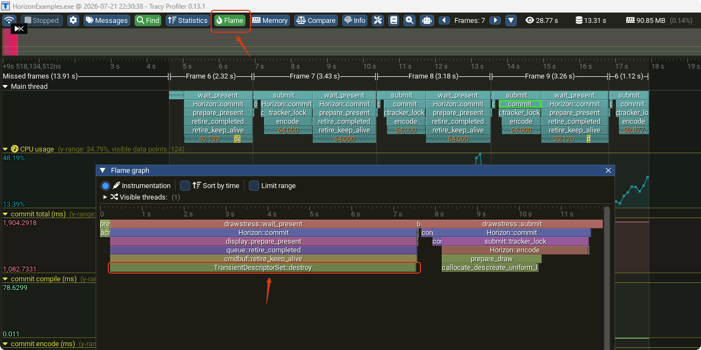

# Horizon

## Windows 构建指南

这份指南适用于第一次接触 CMake 和 Conan 的 Windows 开发者。所有命令都在仓库根目录执行。

### 1. 准备工具

本项目目前只支持 **Windows x64**。推荐按下面顺序安装；安装后重新打开 PowerShell，使 `PATH` 生效。

- Git：用于克隆和更新代码。
- [Miniconda / Conda](https://docs.conda.io/)：管理本项目的开发工具 Python 环境和 Conan。**不需要单独安装 Python 或 Conan。**
- CMake **4.0 或更高版本**和 Ninja：所有 preset 使用 Ninja；两者都必须能在终端中运行。
- Visual Studio 或 Visual Studio Build Tools：安装“使用 C++ 的桌面开发”、MSVC x64/x86 生成工具和 Windows SDK。项目会自动识别本机已安装的 VS/MSVC，不限定某个 VS 年份。
- CUDA Toolkit：仅构建 Ocarina、Ocarina 测试或 Vision Hotfix 时需要；安装后应存在 `CUDA_PATH` 环境变量。
- VS Code 和 **CMake Tools** 扩展：仅在使用 VS Code 构建时需要。

先在 PowerShell 运行以下命令。它们都能显示版本号，就说明基础工具已准备好：

```powershell
git --version
conda --version
cmake --version
ninja --version
```

如果提示“找不到命令”，请检查对应工具是否已安装并加入 `PATH`，然后重新打开终端。克隆项目后，进入仓库根目录并执行一次：

```powershell
conda create --yes --name horizon-dev --override-channels --channel conda-forge "python>=3.11" "conan>=2.28,<3"
```

第一次创建环境和配置会下载或编译 Conan 依赖，耗时较长是正常现象。

若仓库根目录已有 `.venv`，CMake 自动配置会优先使用其中的 Python 和 Conan，
无需先激活环境或安装 Conda。该环境须包含 Python >=3.11 和 Conan >=2.28、<3；
不存在 `.venv` 时，继续使用上面的 Conda 流程。

CLion 使用 Visual Studio 工具链时，可以直接加载项目的 CMake 配置；依赖准备会识别
项目 `.venv`。新增源码或修改 CMake 后执行 **Reload CMake Project**，再构建所需 target。
同时刷新多个配置时，共用 Conan home 的 Horizon 开发脚本会对配方导出、依赖安装和环境
生成加进程锁；等待中的配置会打印提示，前一个依赖准备流程结束后自动继续。
Ninja + MSVC 构建会保存本次配置的 Conan 环境，并在每次 C/C++ 编译、链接时加载，
避免 IDE 缓存的旧版 MSVC 头文件或库路径混入构建。编译输出中的头文件依赖提示会
统一为固定格式，保证终端与 CLion 使用不同输出编码时仍能正确触发头文件重编译。
已有构建目录更新到此配置后，先执行 **Reload CMake Project**；编译命令变化会触发重编译。

### 2. VS Code / CMake Tools 构建

安装 VS Code 的 **CMake Tools** 扩展后，建议启用 VS 开发环境，使 IDE 使用正确的工具链：

1. 打开设置，搜索 `CMake: Use VS Developer Environment`，选择 `always`。
2. 或打开“首选项：打开用户设置(JSON)”，加入：

   ```json
   "cmake.useVsDeveloperEnvironment": "always"
   ```

CMake Tools 会单独启动构建进程。项目已为 Ninja + MSVC 的 C/C++ 编译和链接恢复 Conan 环境；
上面的设置仍能使 IDE 启动的其他开发工具获得一致的 MSVC 和 Windows SDK 环境。

接着打开仓库根目录，按 `Ctrl+Shift+P`：

1. 运行 **CMake: Select Configure Preset**，选择一个 `*-debug` preset。
2. 运行 **CMake: Configure**。
3. 在 CMake 的目标列表中选择需要的 target，再运行 **CMake: Build**。

| 使用场景 | 选择的 Debug preset | 构建目录 |
| --- | --- | --- |
| Horizon / Helicon 核心库 | `core-debug` | `build/conan/core/debug` |
| ShaderCompileScripts | `tools-debug` | `build/conan/tools/debug` |
| HorizonExamples | `examples-debug` | `build/conan/examples/debug` |
| Ocarina | `ocarina-debug` | `build/conan/ocarina/debug` |
| Ocarina 的 `test-*` 测试 | `ocarina-tests-debug` | `build/conan/ocarina-tests/debug` |
| Vision Hotfix | `vision-hotfix-debug` | `build/conan/vision-hotfix/debug` |

旧的 `debug` preset 仍可用，它等同于 `examples-debug`。每个目标族使用独立目录，切换 preset 后请重新执行 Configure，不要把不同目标族混在同一个构建目录里。

### 3. 用脚本构建

脚本会自动执行 Conan 安装、加载 VS 环境并配置 CMake；适合不想操作 IDE 的情况。

```powershell
# 配置 Examples 的 Debug 构建
conda run -n horizon-dev --no-capture-output python tools/dev.py configure --configuration Debug --target-family examples

# 配置并构建一个目标；脚本会从目标名自动判断目标族
conda run -n horizon-dev --no-capture-output python tools/dev.py build HorizonExamples --configuration Debug

# 已配置过时，快速构建该目标族的全部 target
conda run -n horizon-dev --no-capture-output python tools/dev.py build-fast all --configuration Debug --target-family examples
```

把 `examples` 换成 `core`、`tools`、`ocarina`、`ocarina-tests` 或 `vision-hotfix`，即可构建相应目标族。`Debug` 的大小写必须保持不变；还可使用 `Release`、`RelWithDebInfo` 和 `MinSizeRel`。

### 4. 新增 target 和依赖

先确定新 target 属于哪个现有目标族。修改后必须重新执行 Configure，CMake Tools 才会显示新 target。

- **只新增 target，或只使用项目内/已存在的依赖**：只修改对应的 `CMakeLists.txt`，添加 target 并链接已有库；不需要修改 Conan。
- **新增第三方依赖**：同时修改两处。先在 `conanfile.py` 用 `self.requires(...)` 声明依赖，并让它只在需要的目标族启用；再在 CMake 中 `find_package(...)` 并用 `target_link_libraries(...)` 链接。不要在 CMake 中用 `FetchContent` 下载第三方库。
- **希望用脚本直接构建新 target**：若它不符合现有名称规则，还要在 `tools/dev.py` 的 target 到目标族映射中登记；否则脚本可能选择错误的 preset。
- **新增一个完整的目标族**：除 CMake 和 Conan 外，还要新增 CMake preset、Conan 选项、脚本的目标族选项和 target 映射，确保它使用独立的构建目录。

例如，新增一个不引入第三方库的 Ocarina 测试，只需在 `modules/ocarina/tests/CMakeLists.txt` 增加：

```cmake
ocarina_add_test(test-my-check CATEGORY core SOURCES core/test_my_check.cpp)
```

重新配置 `ocarina-tests-debug` 后，`test-core-my-check` 会出现在 target 列表中；不需要修改 Conan。

### 常见问题

- **VS Code 中找不到标准头文件**：确认 `cmake.useVsDeveloperEnvironment` 已手动设置为 `always`，然后重新打开 VS Code 并重新 Configure。
- **Ocarina 配置找不到 CUDA**：安装 CUDA Toolkit，并确认终端执行 `echo $env:CUDA_PATH` 能输出 CUDA 安装目录。
- **第一次构建很慢**：Conan 正在准备依赖；后续使用相同目标族和配置通常会快很多。

---

## 旧版 HardwareWrapper 的构建与验证

旧版接口位于 `include/Horizon_old.h`、`include/HardwareCommands_old.h`，实现位于
`src/HardwareWrapper` 和 `src/HardwareWrapperVulkan`。默认仍构建新版；使用独立构建目录启用旧版：

```powershell
cmake --preset engine-debug -B build/legacy-debug -DHORIZON_USE_LEGACY_BACKEND=ON -DHORIZON_BUILD_TESTS=ON
cmake --build build/legacy-debug --config Debug --target horizon-test-legacy
ctest --test-dir build/legacy-debug -C Debug -L legacy --output-on-failure
```

消费端链接 `Horizon` 并包含 `Horizon_old.h`；目标会传递 `HORIZON_LEGACY_API=1`。
不要手工定义该宏后链接新版库，也不要在同一个程序中混用两套头文件。
当前 examples、Ocarina 和 hotfix 使用新版 API，不能与旧版开关同时启用。

旧代码原先未被 CMake 收集，两份公共头文件也被整体注释，因此默认构建成功并不能证明旧版可编译。
恢复构建后，主要迁移点如下：

| 层次 | 发现的问题 | 修复方式 |
| --- | --- | --- |
| 公共接口 | 旧文件名、缺少有效头文件保护和标准头文件 | 恢复 `_old.h` 声明，所有旧实现显式包含它们 |
| 资源池与日志 | 引用已移除的 Corona Kernel 路径 | 使用已有 `horizon::core::Storage` 和 Core/Quill 日志 |
| 宿主内存 | 引用旧的对齐分配器 | 使用 C++ 对齐 `operator new/delete`，保存分配对齐值，先销毁导入缓冲区再释放内存 |
| 着色器 | `getShaderCode` 已改为可变操作，SPIRV-Cross 反射已移除 | 适配当前 Helicon API，使用 Slang 产生的二进制和反射 |
| 资源自动绑定 | 新版反射条目可能表示常量或缓冲区，旧代码统一按图像解引用 | 分别处理值、缓冲区和图像，并检查空的回指针 |
| Vulkan 链接与初始化 | 重复定义 Volk、依赖未导出的平台扩展变量、全局初始化要求程序启动时就有 GPU | 链接现有 Volk，查询平台扩展入口，首次 GPU 操作时初始化上下文 |
| 拷贝与所有权 | 偏移和长度被丢弃；同一资源重复锁定；部分图像 barrier 与整体布局记录不一致 | 传递并校验拷贝范围；修复同槽锁定；图像转换与整体布局记录保持一致 |
| 图像释放 | `destroyImage` 的释放代码被注释，退出时触发 VMA 泄漏断言 | 分配和缓存视图由共享所有权管理，最后一个图像/子视图释放时销毁 |

旧版仍采用“原子 ID → Storage 槽位 → Vulkan 资源”的引用计数模型。
拷贝命令持有资源包装对象，executor 通过 timeline semaphore 保留资源到 GPU 完成。
测试覆盖头文件独立包含、push constant 的复制/移动/槽位复用、无窗口 displayer、
临时缓冲区保活、整块/局部/同缓冲区拷贝、越界拒绝、图像 mip/数组层/偏移往返和子视图保活，
以及当前 Slang、EDSL 和预编译 Slang 模块的计算管线入口。
CPU 测试不初始化 Vulkan；GPU 测试要求 Vulkan 1.4，无相应 loader/device 时明确返回 CTest 的 skip 状态。
设备存在但初始化、编译或执行失败会报错，不会被当成跳过。

**预编译着色器迁移：** 不再接受单独的 `std::vector<uint32_t>` 来隐式反射 SPIR-V。
请传入当前编译器返回的 `EmbeddedShader::ShaderCodeModule`（含 SPIR-V 和反射）；
`ComputePipeline<CS>` / `RasterizerPipeline<VS, FS>` 使用当前生成器的 `slangModule`。
旧的仅包含 `spirv` 的生成头需要用当前 ShaderCompileScripts 重新生成。
整个迁移不添加第三方库，也不恢复 SPIRV-Cross 或 Corona Kernel。

此开关用于维护旧 API，并不把新版功能全部移植回来。Linux 窗口 surface 创建仍是旧实现中的未完成分支；
GPU 测试不覆盖窗口呈现、跨 GPU 外部内存、所有压缩格式或完整光栅化渲染。
新版公共头和新版后端没有改动；共享 Helicon 仅增加按宏选择资源前置声明的兼容分支。

## tracy用法

1、cmake打开

option(HORIZON_ENABLE_TRACY "Enable Tracy profiler instrumentation" OFF)
->
option(HORIZON_ENABLE_TRACY "Enable Tracy profiler instrumentation" ON)

2、编译启动 example

3、打开tracy-profiler.exe 点Connect

4、如果是一帧里调用多的看 火焰图


## Shader 资源使用与设计

> 注：这是当前最终的设计方案，仍在持续调整中。

Horizon 的着色器资源绑定遵循一套统一约定，核心原则是**全面走 bindless，不再保留非 bindless 路径**。所有资源按数据的生命周期与共享粒度划分到不同的下发通道。

### 数据下发通道

- **Per-object 数据走 Push Constant。**
  每个物体独有、且随 draw 变化的数据（如 model 矩阵、bindless 纹理索引等）直接放进 Push Constant，随 draw call 下发，避免频繁的 descriptor 更新。

- **Push Constant 塞不下时开 SSBO。**
  当 per-object 数据超出 Push Constant 的大小限制时，将数据整体放入一个 SSBO，Push Constant 里只保留一个 **id / 索引**，shader 通过该 id 到 SSBO 中取出对应物体的数据。

- **Per-pass 共享数据走 UBO + Push Descriptor。**
  每个 pass 内部共享、不随单个物体变化的数据（如 view / projection 矩阵、光照参数等）放在 UBO 中，通过 **Push Descriptor** 下发，减少常规 descriptor set 的分配与绑定开销。

- **纹理 / buffer / image 全部 bindless。**
  所有纹理、storage buffer、storage image 均通过 bindless 表访问，shader 侧仅持有索引。已彻底移除非 bindless 的绑定路径。

### Descriptor Set 约定

Set 0–2 为 Horizon 保留的 bindless 集，普通 UBO 一律放在 set 3：

| Set | 用途 |
| --- | --- |
| set 0 | bindless 纹理表（combined image sampler） |
| set 1 | bindless storage buffer |
| set 2 | bindless storage image |
| set 3 | per-pass 共享 UBO（经 Push Descriptor 下发） |

同一个 Push Constant 块在 vertex / fragment 等各阶段之间共享，布局必须严格一致。
